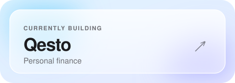
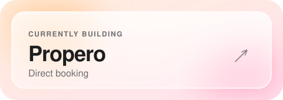
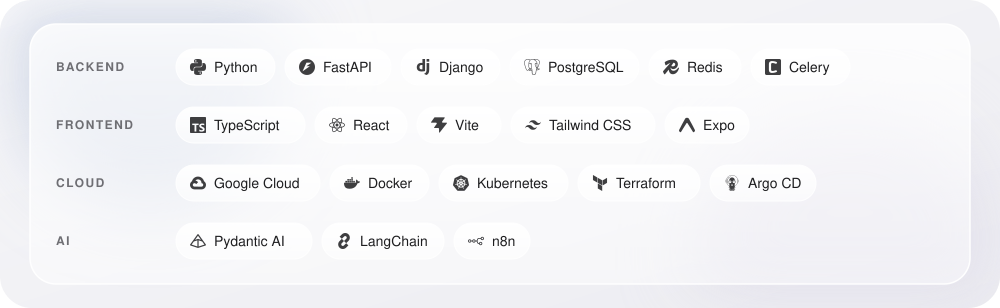

<picture>
  <source media="(prefers-color-scheme: dark)" srcset="assets/hero-dark.svg">
  
</picture>

 

<table align="center">
  <tr>
    <td>
      <a href="https://qesto.app/">
        <picture>
          <source media="(prefers-color-scheme: dark)" srcset="assets/qesto-dark.svg">
          
        </picture>
      </a>
    </td>
    <td>
      <a href="https://2homerent.pl/pl/">
        <picture>
          <source media="(prefers-color-scheme: dark)" srcset="assets/propero-dark.svg">
          
        </picture>
      </a>
    </td>
  </tr>
</table>

<picture>
  <source media="(prefers-color-scheme: dark)" srcset="assets/stack-dark.svg">
  
</picture>

  <a href="https://www.linkedin.com/in/adammisiak/">LinkedIn</a>
  &nbsp;·&nbsp;
  Website (in progress)

